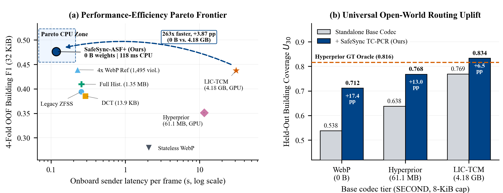
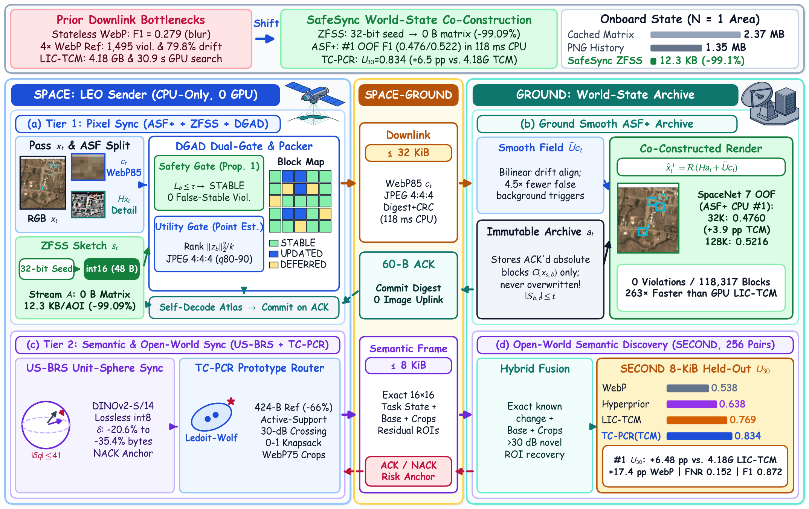

<div align="center">


# SafeSync

**SafeSync: Zero-Footprint Certified State Synchronization and Open-World Semantic Routing for Bandwidth-Constrained LEO Earth Observation**  
**面向带宽受限低轨对地观测的零内存足迹认证状态同步与开放世界语义路由框架**

[](LICENSE)
[](pyproject.toml)
[-2EA44F.svg)](#computational-cost--reproducibility--算力开销与复现环境)
[](#key-empirical-findings--核心实验结果)

[**English**](#english-overview) · [**简体中文**](#中文说明) · [**Editable Architecture (`PPTX` / `SVG`)**](assets/layered_state.pptx) · [**Lessons & Pitfalls / 踩坑复盘**](#design-reflections-failed-attempts--honest-trade-offs--思考过程踩坑复盘与适用边界) · [**Quickstart / 快速上手**](#quickstart--快速开始) · [**Citation / 引用**](#citation--引用说明)

</div>

---

## English Overview

**SafeSync** is an open-source research implementation studying repeated Low-Earth-Orbit (LEO) Earth observation through the lens of **asymmetric space–ground state synchronization**. In real constellations, ground stations can retain persistent high-resolution world-state archives and run heavy analytical models, whereas small satellites operate under tight onboard memory, radiation-tolerant CPU budgets, and short downlink contact windows.

Rather than re-encoding unchanged terrain from scratch on every pass or uplinking bulky historical reference imagery back to orbit, **SafeSync** splits the workload along this physical asymmetry:

- **Pixel Synchronization Tier (`SafeSync-ASF+` / `ZFSS` / `DGAD`)**: Keeps an immutable high-resolution block archive on the ground and only **12.3 KB/AOI** of onboard state (`0 B` persistent projection matrix, `0` neural parameters, `117.5 ms` / `8.51 FPS` on 4 CPU threads), backed by a finite-candidate union-bound reuse certificate (`Proposition 1` + anytime-valid `Corollary 1`) that records **0 false-stable violations across 118,317 valid blocks**.
- **Semantic & Open-World Tier (`US-BRS` / `TC-PCR`)**: Transmits closed-loop `int8` unit-sphere `DINOv2-S/14` feature residuals with zero extra distortion (`20.62%–35.37%` byte savings) and mounts a codec-agnostic 0–1 knapsack residual router (`TC-PCR`) atop `WebP`, `Scale-Hyperprior`, or `LIC-TCM` to raise held-out target evidence coverage up to $U_{30} = 0.8336$ at an 8-KiB cap.

We also explicitly report the **operating regimes where heavy neural codecs remain advantageous** (e.g., high-bitrate 64–128 KiB change-event F1 and global pixel PSNR/SSIM when an onboard GPU is available), along with the failed ablations we encountered while developing this framework. Critique, replication reports, and pull requests are warmly welcome.

<div align="center">

<p><em>Fig. 1. (a) Performance–efficiency Pareto frontier on SpaceNet 7 (32-KiB cap, 4-fold Author-OOF): CPU-only <code>SafeSync-ASF+</code> runs 263× faster than 4.18-GB GPU <code>LIC-TCM</code> while improving building F1 by +3.87 pp. (b) Codec-agnostic <code>TC-PCR</code> consistently lifts held-out building coverage U<sub>30</sub> across all three base codecs on SECOND Cohort 3 (8-KiB cap, 256 pairs).</em></p>
</div>

<div align="center">

<p><em>Fig. 2. Overall dual-tier architecture of SafeSync for asymmetric space–ground state synchronization and co-construction (editable 1:1 PowerPoint &amp; SVG available in <a href="assets/layered_state.pptx"><code>assets/layered_state.pptx</code></a> and <a href="assets/layered_state.svg"><code>assets/layered_state.svg</code></a>).</em></p>
</div>

---

## 中文说明

**SafeSync** 是我们围绕低轨（LEO）高重访对地观测中的**星地资源非对称性**展开的一项开源探索：地面站可以长期保存高分辨率历史地表档案并运行重型分析模型，而星上端受限于存储容量、纯 CPU 算力以及严苛的单轨下行带宽上限（如 32 KiB / 8 KiB）。

在不依赖星上 GPU 加速器、不向星上回传历史参考图像的前提下，我们尝试把协议拆分为两层来回应不同载荷配置的需求：

1. **像素档案同步层（`SafeSync-ASF+` + `ZFSS` + `DGAD`）**：
   - **非对称状态分解（ASF）与平滑重建（ASF+）**：地面维护不可变的高分辨率已确认像素块档案 $a_t$，每轨仅用 1.33 KiB 的 WebP85 粗光照场 $c_t$ 吸收轨间太阳角与季节辐射漂移，配合 60 字节免图像上注确认帧（ACK）保持星地状态一致。通过双线性平滑对齐、7 像素羽化融合及校准集锁定的位置不变 JPEG 4:4:4，在 **0 神经网络参数、4 线程 CPU 仅 117.5 ms（8.51 FPS）** 的开销下，在 SpaceNet 7 四折交叉验证（Author-OOF）的 32 / 64 / 128 KiB 三档预算上分别取得 `0.4760 / 0.4964 / 0.5216` 的建筑分割 F1。
   - **零持久矩阵种子流式草图（ZFSS）与安全复用证明**：从 24 字节事务头部的 32-bit 种子按 512 维分块流式生成正交高斯投影行（持久投影矩阵占 **0 字节**），将每区域星上历史状态压至 **12,328 字节**（较无损 PNG 历史档案降低 **99.09%**）；有限候选集联合界（Proposition 1 + 任意时域有效 Corollary 1）在全部 118,317 个有效块上实测 **0 伪稳定违约**，轨间辐射漂移下背景误触发率控制在 **19.14%–19.37%**（仅为直接 $4\times$ WebP 的约 $1/4$）。
2. **语义特征与开放世界共建层（`US-BRS` + `TC-PCR`）**：
   - **单位球有界残差同步（US-BRS）**：利用冻结 `DINOv2-S/14` 单位球归一化特征的坐标集中性（实测 2,770 万维坐标 $\max|\Delta q| = 41 \le 127$），实现零额外失真的闭环 `int8` 残差编码（节省 **20.62%–35.37%** 字节），并结合 NACK 风险锚点机制在 10%–30% 丢包下加速重同步。
   - **通用即插即用开放世界路由（TC-PCR）**：面向星上未见过的未知新类别变化，结合有效变化支撑集筛选、发送端可见 30 dB 跨阈指示、Ledoit–Wolf 协方差收缩原型距离与逐格 `WebP75` 率失真 0–1 背包，可直接挂载在 `WebP`、`Scale-Hyperprior` 或 `LIC-TCM` 之上，在 SECOND Cohort 3（256 对图像，8 KiB 预算）分别带来 **`+17.37 pp` / `+13.03 pp` / `+6.48 pp`** 的建筑证据覆盖率 $U_{30}$ 提升（最高达 **`0.8336`**，精炼区 Later F1 最高达 **`0.8717`**）。

同时，我们也在文档与实验中如实记录了**高码率 GPU 神经编解码器（`LIC-TCM` / `Hyperprior`）仍然占优的场景**（例如 64–128 KiB 的新目标变化事件 F1 和全局 PSNR/SSIM），以及我们在开发过程中亲自踩过的若干负结果坑，真诚欢迎学术界与工业界同行复现、批评与指正。

---

## Key Empirical Findings / 核心实验结果

### 1. SpaceNet 7 Multi-Temporal Urban Monitoring (8 Confirmation AOIs, 178 Monthly Updates)

<div align="center">

<p><em>Fig. 3. Four-fold cross-validated Author-OOF rate–utility curves across 32, 64, and 128-KiB update caps on SpaceNet 7 (colorblind-safe Okabe-Ito palette).</em></p>
</div>

| Method / 配置 | Onboard State ($N=1$) | Model / Matrix Weights | Sender Time | 32-KiB B-F1 $\uparrow$ | 64-KiB B-F1 $\uparrow$ | 128-KiB B-F1 $\uparrow$ | 32-KiB E-F1 $\uparrow$ | False-Stable Viol. $\downarrow$ |
| :--- | :---: | :---: | :---: | :---: | :---: | :---: | :---: | :---: |
| **SafeSync-ASF+ (Ours)** | **12.3 KB** | **0 B (streamed)** | **117.5 ms (4-thr CPU)** | **0.4760** | **0.4964** | **0.5216** | 0.1899 | **0 / 118,317 (0%)** |
| SafeSync-DGAD (Legacy Block) | 12.3 KB | 0 B (streamed) | 254.7 ms (4-thr CPU) | 0.4250 | 0.4377 | 0.4431 | 0.1337 | 0 (0.00%) |
| SafeSync-ZFSS (Legacy Coupled) | 12.3 KB | 0 B (streamed) | 254.7 ms (4-thr CPU) | 0.3943 | 0.4122 | 0.4308 | 0.1418 | 0 (0.00%) |
| Deterministic DCT Bound | 13.9 KB | 0 B | 291.2 ms (4-thr CPU) | 0.3852 | 0.3975 | 0.4316 | 0.1050 | 0 (0.00%) |
| Low-Res $4\times$ WebP Thumbnail | 10.7 KB | 0 B | 226.4 ms (4-thr CPU) | 0.4390* | 0.4475* | 0.4526* | 0.1386 | 1,495 (21.79%) |
| Stateless Full WebP | 241 B (meta) | 0 B | 2,063.1 ms search (CPU) | 0.2794 | 0.3788 | 0.4698 | 0.1020 | N/A (stateless) |
| Scale-Hyperprior (`q1..8`) | 241 B (meta) | 61.1 MB | 11.54 s GPU / 36.4 s CPU | 0.3513 | 0.4623 | 0.5181 | 0.1693 | N/A (stateless) |
| LIC-TCM (35 candidates) | 241 B (meta) | 4,179.9 MB | 30.88 s GPU search | 0.4374 | 0.4957 | 0.5076 | **0.2255** | N/A (stateless) |

> *Honest Operating-Regime Note / 客观边界说明*: `SafeSync-ASF+` achieves the highest 4-fold Author-OOF building F1 across all three caps on CPU (`263×` faster than 35-candidate GPU `LIC-TCM`, `0 B` codec weights, `0` false-stable violations). When an onboard GPU and higher downlink budgets (`64–128 KiB/frame`) are available, `LIC-TCM` and `Scale-Hyperprior` remain stronger on **new-track event F1** (`0.2712–0.2825` vs. `0.2288–0.2654`) and **global PSNR/SSIM**. Note also that `4× WebP` reaches `0.4390*` on clean sequences only when given SafeSync's coarse restoration layer, while committing 1,495 false-stable violations and suffering **79.80%** background false triggers under pass-to-pass orbital radiometric drift (vs. **19.14%** for `SafeSync-ASF+`).

<div align="center">

<p><em>Fig. 4. Six-way native-resolution 32-KiB visual comparison on SpaceNet 7 Test Area 2 (2018-02) and Area 5 (2019-03) with dedicated 2.7× vermilion-boxed rooftop zoom-in strips. Even at 32 KiB on CPU, <code>SafeSync-ASF+</code> preserves sharp 4-m building corners (33.7 dB / 37.2 dB) where stateless <code>WebP</code>, <code>Hyperprior</code>, and <code>LIC-TCM</code> soften thin construction edges.</em></p>
</div>

---

### 2. State Scaling, Drift Immunity & Universal Plug-and-Play TC-PCR on SECOND (Cohort 3, 256 Pairs, 8-KiB Cap)

<div align="center">

<p><em>Fig. 5. (a) Multi-AOI onboard state scaling; (b) reuse safety violations and orbital-drift false-trigger rates; (c) state footprint vs. 32-KiB Author-OOF building F1; (d) codec-agnostic <code>TC-PCR</code> uplift across WebP, Hyperprior, and LIC-TCM on SECOND Cohort 3 at 8 KiB.</em></p>
</div>

| SECOND Cohort 3 Method (8-KiB Cap, Building Held-Out) | Base Codec Weights | Mean Payload | Held-Out $U_{30}$ $\uparrow$ | Gain vs. Standalone | Held-Out FNR $\downarrow$ | Global / Refined Later F1 $\uparrow$ |
| :--- | :---: | :---: | :---: | :---: | :---: | :---: |
| Stateless Full WebP | 0 B (+DINO task) | 7.91 KiB | 0.5380 | — | 0.1699 | 0.8332 / 0.8332 |
| **SafeSync TC-PCR (WebP Base)** | **0 B (+DINO task)** | 7.86 KiB | **0.7117** | **+17.37 pp** ($>$ Hyperprior) | 0.1747 (**0.0997** ref.) | 0.8209 / **0.8717** |
| Full Scale-Hyperprior | 61.1 MB | 7.36 KiB | 0.6379 | — | 0.1965 | 0.8212 / 0.8212 |
| **SafeSync TC-PCR (Hyperprior Base)** | **61.1 MB** | 7.73 KiB | **0.7682** | **+13.03 pp** (-36.0% UMR) | 0.1776 (0.1017 ref.) | 0.8133 / 0.8635 |
| Full LIC-TCM (35-cand. GPU SOTA) | 4,179.9 MB | **7.31 KiB** | 0.7688 | — | 0.1891 | 0.8268 / 0.8268 |
| **SafeSync TC-PCR (LIC-TCM Base)** | **4,179.9 MB** | 7.57 KiB | **0.8336** | **+6.48 pp** (-28.0% UMR) | 0.1693 (0.1053 ref.) | 0.8237 / 0.8633 |
| **SafeSync TC-PCR (LIC-TCM Raw)** | **4,179.9 MB** | 7.86 KiB | 0.8116 | +4.29 pp | **0.1523** | 0.8239 / — |
| Post-Hoc Hyperprior GT Oracle | 61.1 MB | 7.80 KiB | 0.8163 | Offline GT ceiling | 0.1576 | 0.8214 / — |

---

## Design Reflections, Failed Attempts & Honest Trade-Offs / 思考过程、踩坑复盘与适用边界

Working under strict zero-training, hard byte-cap, and frozen-evaluator constraints taught us several humbling lessons. Many intuitive "improvements" actually **hurt** downstream metrics when verified on locked confirmation AOIs. We document both what worked and what failed so other researchers do not repeat the same dead ends:

1. **Why our early block-piecewise `ASF` lost `-8.18 pp` to `SafeSync-ASF+` (`0.3943 -> 0.4760`)**: Our first prototype satisfied Proposition 1 with zero violations, yet trailed GPU `LIC-TCM` by `-4.31 pp`! Visual crop inspection revealed why: $16\times 16$ nearest-neighbor coarse tiling injected false staircase edges into frozen EfficientNet-B3 early conv filters, while JPEG coarse encoding quietly burned `8.40 KiB` of a `32-KiB` cap. Moving to WebP85 coarse (`1.33 KiB`), bilinear transfer $\widetilde U$, $r=7$-px feathering, and calibration-locked position-invariant JPEG 4:4:4 kept Proposition 1 untouched and resolved the bottleneck.
2. **The hidden `2.36 MB` projection-matrix trap at $N=1$**: Storing a $24\times 12{,}288$ `float64` matrix `A` takes `2.36 MB`—*larger* than a lossless PNG history archive for a single AOI! Streaming row-orthonormal Gaussian rows in 512-coordinate chunks from a 32-bit header seed removed all `2.36 MB` of persistent matrix RAM while remaining numerically identical across 47,616 blocks (max float discrepancy $5.55\times 10^{-16}$).
3. **Three intuitive ablations that *failed* (and were rejected on evidence)**:
   - *Finer `32×32` tiling (`k=12`)*: Intuitively expected to localize smaller buildings better, but fragmented U-Net receptive fields across more seams, **dropping** dev building F1 by `-2.7` to `-3.7 pp` while doubling onboard state (`24.6 KB/AOI`).
   - *Edge-weighted block ranking*: Prioritizing high-gradient blocks increased per-block JPEG cost, **cutting** the number of transmitted blocks by `12%–18%` and losing blind 8-AOI OOF F1 across all three caps (`0.4743 / 0.4961 / 0.5168`).
   - *Zero-training ground-side post-filters (`G1–G5`)*: Bilateral smoothing, unsharp masking, and seam blending consistently degraded frozen U-Net predictions because the evaluator was trained on unsmoothed native Planet imagery.
4. **Why global PSNR/SSIM anti-correlates with 4-m rooftop detection**: Across 2,136 decoded SpaceNet 7 frames, stateless codecs achieve higher current-frame SSIM (`0.9602` vs. `0.8414`) because they spend bits reproducing pass-$t$ atmospheric/seasonal shading, yet blur 4-pixel rooftop corners and lose up to `-19.66 pp` F1. Optimizing rate–distortion metrics alone can silently harm small-object remote sensing utility.
5. **Why `TC-PCR` needed active-support voting**: On SECOND Cohort 3, naive full-image residual routing was outvoted by ~53 unchanged background cells. Restricting packet decisions strictly to the active changed support and explicitly rewarding 30-dB threshold crossings unlocked monotonic gains across every base codec.

> **中文复盘精华（真实踩坑记录）**：
> - **早期分块 `ASF` 坑（`-8.18 pp`）**：初版 $16\times 16$ 最近邻块拼接虽满足 0 违约，但会在复用区制造棋盘格伪边缘误导冻结 U-Net，且粗光照场 JPEG 偷走 `8.40 KiB`；改为 WebP85（`1.33 KiB`）+ 双线性平滑对齐 + 位置无关 JPEG 4:4:4 才真正打通低码率性能。
> - **单区域 `2.36 MB` 投影矩阵坑**：若把 $24\times 12288$ 双精度矩阵常驻内存，单区域（$N=1$）比无损 PNG 还占内存；改为 32-bit 种子按 512 维流式重生成后，才实现单/多区域稳定减容 **99.09%**。
> - **三个直觉上“应该更好”但实测翻车的改动**：(1) 细分 `32×32` 网格反而打碎 U-Net 感受野，导致验证集 F1 掉 **`-2.7 ~ -3.7 pp`** 且状态翻倍；(2) 边缘加权排序因高纹理块编码更贵，导致可传块数减少 **`12%–18%`**、盲测三档全降；(3) 地面端零训练后处理滤波（`G1–G5`）破坏了冻结评估器对原生锐利像素的分布预期。
> - **像素指标与 4 米建筑分割的背离**：无状态编解码器重编码当轨季节色差而拿到更高全局 SSIM，却糊掉了小目标屋顶；开放世界路由中同样必须把裁决限定在**有效变化支撑集**并奖励 **30 dB 跨阈块**，才能防止大量静态背景块淹没真正的未知变化。

---

## Repository Structure / 目录结构

```text
SafeSync/
├── assets/                  # Publication figures & editable Fig. 2 (PPTX / SVG) / 论文图表与可编辑框架图
├── benchmarks/              # Summary CSV/JSON tables for quick inspection / 核心实验统计汇总表
├── configs/                 # Deterministic protocol and experiment configs / 协议与实验配置
├── docs/                    # Protocol specifications & reproducibility notes / 协议说明与复现文档
├── safesync/                # Core Python library (ASF+, ZFSS, DGAD, US-BRS, TC-PCR) / 核心算法库
├── scripts/                 # Evaluation, profiling, plotting & verification scripts / 实验与绘图脚本
├── tests/                   # Unit & wire-protocol contract tests (pytest) / 单元测试与协议契约测试
├── CITATION.cff             # Standardized software citation metadata / 标准引用元数据
├── LICENSE                  # MIT License & third-party data/model notices / 开源许可与第三方声明
├── pyproject.toml           # Package metadata & dependencies / 项目元数据与依赖配置
└── requirements.txt         # Pinned lightweight Python dependencies / 依赖列表
```

---

## Quickstart / 快速开始

### 1. Environment Setup / 安装环境

```bash
git clone https://github.com/WYH302/SafeSync.git
cd SafeSync
pip install -r requirements.txt
```

### 2. Run Protocol & Unit Tests / 运行协议与单元测试（纯 CPU，仅需数秒）

```bash
pytest -q
```

This verifies zero-footprint seeded chunk streaming (`ZFSS`), asymmetric state factorization (`ASF` / `ASF+`), dual-gate decoupling (`DGAD`), `US-BRS` lossless `int8` residual bounds, and `TC-PCR` prototype routing contracts purely on CPU without downloading multi-gigabyte datasets.

### 3. Regenerate Architecture & Teaser Figures / 重新生成论文框架图与帕累托图

```bash
python scripts/draw_layered_method.py
python scripts/build_teaser_pareto_figure.py
```

For full dataset preparation (`SpaceNet 7` and `SECOND`) and end-to-end neural baseline reproduction (`CompressAI` and `LIC-TCM`), please see [`docs/REPRODUCIBILITY.md`](docs/REPRODUCIBILITY.md).

---

## Computational Cost & Reproducibility / 算力开销与复现环境

All benchmark experiments in our study were conducted without any model training or fine-tuning on a single workstation:

- **Hardware**: AMD Ryzen 7 5700X CPU (pinned to 4 threads for sender benchmarks) + NVIDIA GeForce RTX 3090 GPU (24 GB VRAM)
- **Software**: Python 3.11 / 3.12, PyTorch `2.8.0+cu128`, CUDA `12.8`, NumPy `2.4`, Pillow `12.2`, OpenJPEG `2.5.4`
- **Total Campaign Compute**:
  - **8.42 RTX 3090 GPU-hours** in total across all neural baselines, downstream evaluations, and supplementary audits (`1.70 h` SpaceNet 7 `LIC-TCM`, `1.69 h` SECOND `LIC-TCM`, `0.82 h` SpaceNet 7 `Scale-Hyperprior` under a 1.8 GB VRAM cap, `1.39 h` SECOND `Hyperprior`/`DINOv2-S/14`/`TC-PCR v2`, `1.08 h` primary `U-Net` evaluation, and `1.74 h` supplementary `exp0200`/orbital-drift/refined-ROI/cross-architecture audits; **0.00 training hours**).
  - **0.00 GPU-hours / 0 MB VRAM / 0 neural params / 0.157 GFLOPs per 1024² frame** for **SafeSync's pixel-tier sender** (`117.5 ms` / **`8.51 FPS`** at 32 KiB, `136.7 ms` / `7.32 FPS` at 64 KiB, `173.7 ms` / `5.76 FPS` at 128 KiB on 4 CPU threads; `20.9 s` per 178-update pass).
  - **5.32 CPU-hours** across all stateful protocol transactions, orbital-drift tests, archive profiling, and 10,000-resample paired geographic bootstrap intervals.

---

## Citation / 引用说明

If you find this codebase, protocol design, or ablation analysis helpful in your work, please consider citing:

```bibtex
@article{wu2026safesync,
  author  = {Wu, Yonghao},
  title   = {{SafeSync}: Zero-Footprint Certified State Synchronization and Open-World Semantic Routing for Bandwidth-Constrained {LEO} {Earth} Observation},
  journal = {IEEE Transactions},
  year    = {2026},
  note    = {Manuscript under review; code available at https://github.com/WYH302/SafeSync}
}
```

## Acknowledgments / 致谢

We sincerely thank the authors and maintainers of [SpaceNet 7](https://spacenet.ai/sn7-challenge/), [SECOND](https://captain-whu.github.io/SCD/), [CompressAI](https://github.com/InterDigitalInc/CompressAI), [LIC-TCM](https://github.com/jmliu206/LIC_TCM), and [DINOv2](https://github.com/facebookresearch/dinov2) for sharing public datasets, reference implementations, and pretrained checkpoints. Questions, critical feedback, issue reports, and pull requests are always welcome.
