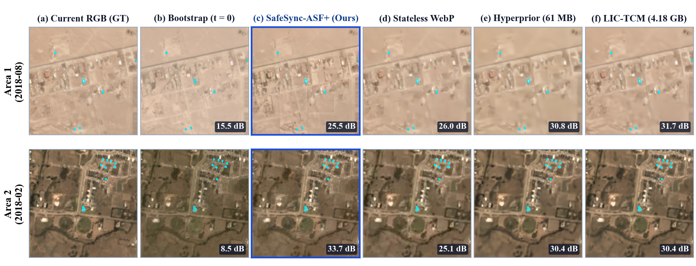

<div align="center">


# SafeSync

**SafeSync: Breaking the Satellite Downlink Bottleneck via Zero-Footprint Asymmetric Space-Ground State Co-Construction**  
**突破卫星下行瓶颈的零内存足迹非对称星地状态共建框架**

[](LICENSE)
[](pyproject.toml)
[-2EA44F.svg)](#computational-cost--reproducibility--算力开销与复现环境)
[](#key-empirical-findings--核心实验结果)

[**English**](#english-overview) · [**简体中文**](#中文说明) · [**Editable Fig. 1 (`PPTX` / `SVG`)**](assets/layered_state.pptx) · [**Quickstart / 快速上手**](#quickstart--快速开始) · [**Citation / 引用**](#citation--引用说明)

</div>

---

## English Overview

**SafeSync** is an open-source research implementation exploring repeated satellite Earth observation from the perspective of **asymmetric space-ground state synchronization**. In Low-Earth-Orbit (LEO) monitoring scenarios, ground stations can retain persistent high-resolution archives and run heavy analytical models, whereas satellites operate under tight memory, processor, and downlink budgets.

Rather than re-encoding each revisit from scratch or uplinking historical reference imagery, SafeSync studies how a lightweight onboard sender and a persistent ground archive can maintain a synchronized world state across both pixel archives and semantic representations, while openly documenting the operating regimes where full-frame GPU neural codecs remain advantageous.

<div align="center">

<p><em>Fig. 1. Overview of the SafeSync dual-tier space-ground state synchronization and co-construction architecture.</em></p>
</div>

### Core Technical Modules

1. **Asymmetric State Factorization (`ASF`) & Adaptive-History Reuse Certificate**
   - Separates an immutable ground archive of acknowledged absolute image blocks from a pass-specific $4\times 4$ coarse illumination field (`LB01`), committing updates via a **60-byte uplink-free ACK**.
   - Restricts adaptive archive histories to a finite candidate set, enabling a union-bound reuse certificate (`Proposition 1`) with **0 false-stable block violations** across 118,317 evaluated blocks across all three caps.
2. **Zero-Footprint Seeded Sketching (`ZFSS`) & Dual-Gate Asymmetric Decoupling (`DGAD`)**
   - Streams row-orthonormal Gaussian projections in 512-coordinate chunks directly from a 32-bit seed stored in the 24-byte `SC02` header (**0 bytes** persistent matrix memory), keeping persistent historical state at **12,328 bytes per $1024\times 1024$ area** ($99.09\%$ smaller than lossless PNG history even at $N=1$).
   - Decouples conservative $\chi^2_{24}(\alpha)$ safety certification (`STABLE`) from unbiased point-estimate candidate ranking (`UPDATED`).
3. **Unit-Sphere Bounded Residual Synchronization (`US-BRS`) & Prototype-Calibrated Routing (`TC-PCR`)**
   - Exploits unit-sphere token concentration on frozen `DINOv2-S/14` features ($\max|\Delta q|=41 \le 127$) for **100% lossless closed-loop `int8` residuals** ($20.62\%\text{--}35.37\%$ byte savings over open-loop delta coding) alongside NACK-triggered `Risk Anchor` erasure recovery.
   - Combines active-support packet selection, sender-visible 30-dB threshold-crossing prioritization, and Ledoit–Wolf shrinkage-calibrated prototype distances for open-world semantic change discovery (`TE01/RE01`).

---

## 中文说明

**SafeSync** 是一个面向低轨星座重复对地观测场景的开源研究项目，尝试从**非对称星地状态同步与空地共建**的视角探讨星上下行瓶颈问题：地面站具备充足的持久化存储与算力来维护高分辨率历史状态档案，而星上端往往受到存储容量、处理器算力以及单轨下行带宽的严格限制。

本项目不追求替代所有场景下的全图深度编解码器，而是重点探索**在无星上 GPU、无历史参考图上注、严格单帧带宽上限（如 32 KiB / 8 KiB）**的条件下，如何通过轻量级闭环状态同步兼顾背景安全复用与新增目标证据保留，并如实对比和划定重型 GPU 神经编解码器占优的高码率区间，供同行参考、复现与改进。

### 方法组成概览

- **第一层：像素档案层同步（`ASF` + `ZFSS` + `DGAD`）**
  - **非对称状态分解（ASF）**：地面端将已确认的绝对像素块档案 $a_t$ 与当轨 $4\times 4$ 粗粒度光照场 $c_t$（`LB01`）解耦，仅通过 **60 字节免图像上注确认帧（ACK）** 保持星地状态一致，避免闭环渲染回写导致的误差累积，并通过有限候选集联合界（Proposition 1）保证自适应历史选择下的安全复用（三档码率实测 118,317 块中伪稳定违约数为 **0**）。
  - **零持久矩阵种子流式草图（ZFSS）**：从 `SC02` 摘要头部的 32-bit 种子按 512 维分块流式生成正交高斯投影行，持久投影矩阵开销为 **0 字节**，单区域（$N=1$）与多区域（$N=8$）历史状态均压缩至 **12.3 KB/区域**（较无损 PNG 历史档案节省 **99.09%**）。
  - **双门限非对称解耦（DGAD）**：将保守的 $\chi^2_{24}(\alpha)$ 安全认证门限与无偏点估计候选排序解耦，在保持 0 伪稳定违约的同时提升低码率建筑分割与抗轨间辐射漂移能力。
- **第二层：语义特征与开放世界共建层（`US-BRS` + `TC-PCR`）**
  - **单位球有界残差同步（US-BRS）**：利用归一化 `DINOv2-S/14` 特征在单位球面上的坐标集中特性，实现零额外失真的闭环 `int8` 特征残差传输（节省 $20.62\%\text{--}35.37\%$ 字节），并支持丢包场景下的 NACK 风险锚点（`Risk Anchor`）快速重同步。
  - **跨阈原型校准路由（TC-PCR）**：结合有效支撑集包选择、发送端可见 30 dB 跨阈指示以及 Ledoit–Wolf 协方差收缩校准原型距离，在严格 8 KiB 预算下保护开放世界新类别局部证据。

---

## Key Empirical Findings / 核心实验结果

### 1. SpaceNet 7 Multi-Temporal Urban Monitoring (8 Confirmation AOIs, 178 Monthly Updates)

<div align="center">

<p><em>Fig. 2. Four-fold cross-validated Author-OOF rate–utility curves across 32, 64, and 128-KiB update caps on SpaceNet 7.</em></p>
</div>

| Method / 配置 | Onboard State ($N=1$) | Model / Matrix Weights | Sender Time | 32-KiB B-F1 $\uparrow$ | 64-KiB B-F1 $\uparrow$ | 128-KiB B-F1 $\uparrow$ | 32-KiB E-F1 $\uparrow$ | False-Stable Viol. $\downarrow$ |
| :--- | :---: | :---: | :---: | :---: | :---: | :---: | :---: | :---: |
| **SafeSync-ASF+ (Ours)** | **12.3 KB** | **0 B (streamed)** | **117.5 ms (4-thr CPU)** | **0.4760** | **0.4964** | **0.5216** | 0.1899 | **0 / 118,317 (0%)** |
| SafeSync-DGAD (Legacy Block) | 12.3 KB | 0 B (streamed) | 254.7 ms (4-thr CPU) | 0.4250 | 0.4377 | 0.4431 | 0.1337 | 0 (0.00%) |
| SafeSync-ZFSS (Legacy Coupled) | 12.3 KB | 0 B (streamed) | 254.7 ms (4-thr CPU) | 0.3943 | 0.4122 | 0.4308 | 0.1418 | 0 (0.00%) |
| Deterministic DCT Bound | 13.9 KB | 0 B | 291.2 ms (4-thr CPU) | 0.3852 | 0.3975 | 0.4316 | 0.1050 | 0 (0.00%) |
| Low-Res $4\times$ WebP Thumbnail | 10.7 KB | 0 B | 226.4 ms (4-thr CPU) | 0.4390* | 0.4475* | 0.4526* | 0.1386 | 1,495 (21.79%) |
| Stateless Full WebP | 241 B (meta) | 0 B | 2,063.1 ms search (CPU) | 0.2794 | 0.3788 | 0.4698 | 0.1020 | N/A (stateless) |
| Scale-Hyperprior (`q1..8`) | 241 B (meta) | 61.1 MB | 11.54 s GPU / 36.4 s CPU | 0.3513 | 0.4623 | 0.5181 | 0.1693 | N/A (stateless) |
| LIC-TCM (35 candidates) | 241 B (meta) | 4,179.9 MB | 30.88 s GPU search | 0.4374 | 0.4957 | 0.5076 | **0.2255** | N/A (stateless) |

> *Note / 说明*：`SafeSync-ASF+` ranks **#1 in four-fold Author-OOF building F1 across all three caps (32, 64, 128 KiB)** on CPU with 0 B codec weights and 0 false-stable violations across all 118,317 blocks ($263\times$ faster than GPU LIC-TCM). Heavy GPU codecs (`LIC-TCM` / `Hyperprior`) retain an event-F1 edge at 64–128 KiB. `4x WebP` reaches 0.4390* on clean sequences only when granted SafeSync's `LB01` coarse restoration while committing 1,495 false-stable violations; without `LB01` under pass-to-pass orbital radiometric drift, direct `4x WebP` suffers **79.80%** background false triggers (vs. **19.37%** for SafeSync).

<div align="center">

<p><em>Fig. 3. Native-resolution decoded crops at the 32-KiB cap on SpaceNet 7 (cyan outlines indicate ground-truth new-track buildings).</em></p>
</div>

---

### 2. State Scaling, Drift Immunity & Universal Plug-and-Play TC-PCR on SECOND (Cohort 3, 256 Pairs, 8-KiB Cap)

<div align="center">

<p><em>Fig. 4. (a) Multi-AOI persistent state scaling; (b) reuse safety violations and orbital-drift false-trigger rates; (c) SpaceNet 7 state footprint vs. 32-KiB Author-OOF building F1; (d) universal codec-agnostic TC-PCR across WebP, Hyperprior, and LIC-TCM on SECOND Cohort 3 at 8 KiB.</em></p>
</div>

| SECOND Cohort 3 Method (8-KiB Cap, Building Held-Out) | Base Codec Weights | Mean Payload | Held-Out $U_{30}$ $\uparrow$ | Gain vs. Standalone | Held-Out FNR $\downarrow$ | Global / Refined Later F1 $\uparrow$ |
| :--- | :---: | :---: | :---: | :---: | :---: | :---: |
| Stateless Full WebP | 0 B (+DINO task) | 7.91 KiB | 0.5380 | — | 0.1699 | 0.8332 / 0.8332 |
| **SafeSync TC-PCR (WebP Base)** | **0 B (+DINO task)** | 7.88 KiB | **0.6913** | **+15.33 pp** ($>$ Hyperprior!) | 0.1739 | 0.8222 / — |
| Full Scale-Hyperprior | 61.1 MB | 7.36 KiB | 0.6379 | — | 0.1965 | 0.8212 / 0.8212 |
| **SafeSync TC-PCR (Hyperprior Base)** | **61.1 MB** | 7.72 KiB | **0.7594** | **+12.15 pp** (-33.6% UMR) | 0.1763 | 0.8154 / **0.8503** |
| Full LIC-TCM (35-cand. GPU SOTA) | 4,179.9 MB | **7.31 KiB** | 0.7688 | — | 0.1891 | 0.8268 / 0.8268 |
| **SafeSync TC-PCR (LIC-TCM Base)** | **4,179.9 MB** | 7.55 KiB | **0.8233** | **+5.45 pp** (-23.6% UMR) | 0.1728 | 0.8257 / — |
| **SafeSync TC-PCR (LIC-TCM Raw)** | **4,179.9 MB** | 7.82 KiB | 0.7994 | +3.06 pp | **0.1571** | 0.8244 / — |
| Post-Hoc Hyperprior GT Oracle | 61.1 MB | 7.80 KiB | 0.8163 | Offline GT ceiling | 0.1576 | 0.8214 / — |

---

## Repository Structure / 目录结构

```text
SafeSync/
├── assets/                  # Architecture diagrams and benchmark result figures / 架构图与实验结果图
├── benchmarks/              # Summary CSV/JSON tables for quick inspection / 核心实验统计汇总表
├── configs/                 # Deterministic protocol and experiment configs / 协议与实验配置
├── docs/                    # Protocol specifications & reproducibility notes / 协议说明与复现文档
├── safesync/                # Core Python library (ASF, ZFSS, DGAD, US-BRS, TC-PCR) / 核心算法库
├── scripts/                 # Evaluation, profiling, plotting & verification scripts / 实验与绘图脚本
├── tests/                   # Unit & wire-protocol contract tests (pytest) / 单元测试与协议契约测试
├── LICENSE                  # MIT License & third-party data/model notices / 开源许可与第三方声明
├── pyproject.toml           # Package metadata & dependencies / 项目元数据与依赖配置
└── requirements.txt         # Pinned lightweight Python dependencies / 依赖列表
```

---

## Quickstart / 快速开始

### 1. Environment Setup / 安装环境

```bash
git clone https://github.com/WYH302/SafeSync.git
cd SafeSync
pip install -r requirements.txt
```

### 2. Run Protocol & Unit Tests / 运行协议与单元测试（纯 CPU，仅需数秒）

```bash
pytest -q
```

This verifies `SC02` zero-footprint seeded chunk streaming (`ZFSS`), `LB01/LA01` asymmetric state factorization (`ASF`), dual-gate decoupling (`DGAD`), `US-BRS` lossless `int8` residual bounds, and `TC-PCR` prototype routing contracts on CPU without downloading multi-gigabyte datasets.

### 3. Regenerate Figures & Summary Tables / 重新生成论文图表

```bash
python scripts/draw_layered_method.py
```

For full dataset preparation (`SpaceNet 7` and `SECOND`) and end-to-end neural baseline reproduction (`CompressAI` and `LIC-TCM`), please see [`docs/REPRODUCIBILITY.md`](docs/REPRODUCIBILITY.md).

---

## Computational Cost & Reproducibility / 算力开销与复现环境

All benchmark experiments in our study were conducted without any model training or fine-tuning on a single workstation:

- **Hardware**: AMD Ryzen 7 5700X CPU (pinned to 4 threads for sender benchmarks) + NVIDIA GeForce RTX 3090 GPU (24 GB VRAM)
- **Software**: Python 3.11 / 3.12, PyTorch `2.8.0+cu128`, CUDA `12.8`, NumPy `2.4`, Pillow `12.2`, OpenJPEG `2.5.4`
- **Total Campaign Compute**:
  - **6.48 RTX 3090 GPU-hours** in total across all neural baselines and downstream evaluations (`1.70 h` SpaceNet 7 `LIC-TCM`, `1.69 h` SECOND `LIC-TCM`, `0.82 h` SpaceNet 7 `Scale-Hyperprior`, `1.19 h` SECOND `Hyperprior`/`DINOv2-S/14`, and `1.08 h` `U-Net` receiver evaluation).
  - **0.00 GPU-hours** for **SafeSync's pixel-tier sender** (`117.5 ms/update` on 4 CPU threads for `SafeSync-ASF+`, `20.9 s` per 178-update pass; `254.7 ms` for legacy `ZFSS/DGAD`).
  - **5.32 CPU-hours** across all stateful protocol transactions, orbital-drift tests, archive profiling, and 10,000-resample paired geographic bootstrap intervals.

---

## Citation / 引用说明

If you find this repository or the experimental protocols helpful in your research, please consider citing:

```bibtex
@article{wu2026safesync,
  author  = {Wu, Yonghao},
  title   = {{SafeSync}: Breaking the Satellite Downlink Bottleneck via Zero-Footprint Asymmetric Space-Ground State Co-Construction},
  journal = {IEEE Transactions on Geoscience and Remote Sensing},
  year    = {2026},
  note    = {Code available at https://github.com/WYH302/SafeSync}
}
```

## Acknowledgments / 致谢

We sincerely thank the teams behind [SpaceNet 7](https://spacenet.ai/sn7-challenge/), [SECOND](https://captain-whu.github.io/SCD/), [CompressAI](https://github.com/InterDigitalInc/CompressAI), [LIC-TCM](https://github.com/jmliu206/LIC_TCM), and [DINOv2](https://github.com/facebookresearch/dinov2) for sharing their public datasets, codebases, and pretrained checkpoints with the research community. Feedback, issues, and pull requests are always welcome.
